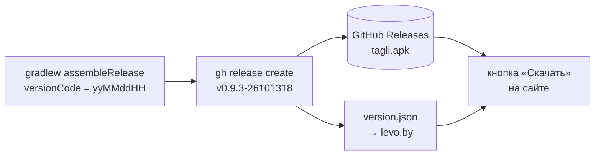

# Tagli

Трекер калорий для Android. Исходники приватные, в этом репозитории публикуются только сборки.

[](https://github.com/veomall/tagli/releases/latest)
[](https://github.com/veomall/tagli/releases)
[](https://github.com/veomall/tagli/releases/latest)
[](https://levo.by)

## Скачать

**[⬇ tagli.apk — последняя сборка](https://github.com/veomall/tagli/releases/latest/download/tagli.apk)**

```
https://github.com/veomall/tagli/releases/latest/download/tagli.apk
```

<details>
<summary>Установка</summary>

1. Скачай `tagli.apk` на телефон.
2. Открой файл. Android попросит разрешить установку из этого источника (браузер или «Файлы») — разреши.
3. Если Play Protect предупреждает про неизвестное приложение — «Всё равно установить». Сборка не из Google Play.
4. Новая сборка ставится поверх старой, данные сохраняются.

Через `adb`:

```
adb install -r tagli.apk
```

</details>

## Как устроены релизы



## Следить за релизами

- **Watch → Custom → Releases** — уведомление о каждой новой сборке.
- Atom-лента: [`releases.atom`](https://github.com/veomall/tagli/releases.atom)
- GitHub CLI и API:

```bash
gh release download --repo veomall/tagli --pattern tagli.apk
curl -s https://api.github.com/repos/veomall/tagli/releases/latest | jq -r .tag_name
```

## Стек

| Слой | Технологии |
|---|---|
| Клиент | Android |
| Бэкенд | Java 21, Spring Boot: core-server + edge-gateway |
| База | PostgreSQL 18, миграции Flyway |
| Периметр | Caddy 2, автоматический TLS (Let's Encrypt), HTTP/3 |
| Бот | Python 3.12, Telegram |
| Деплой | Docker Compose на одном VPS, выкладка по SSH из Update Center, откат одной командой |
